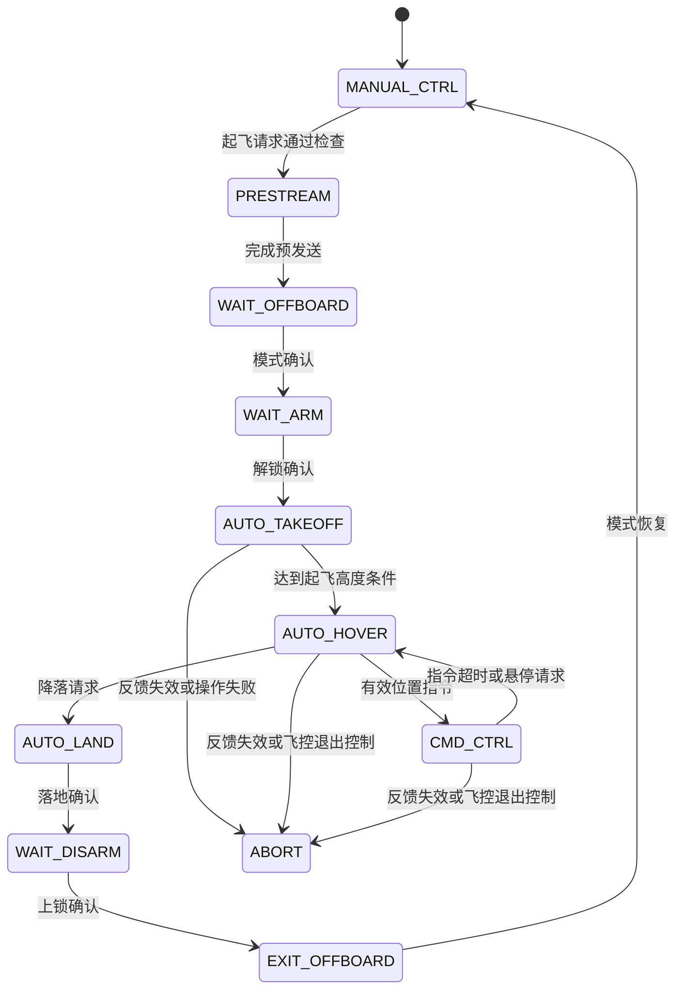

# px4ctrl2 文件架构与模块说明

## 1. 模块定位

`px4ctrl2` 是面向 ROS 2 的外部位置控制包。节点接收定位反馈和位置参考，计算目标姿态及归一化推力，通过 MAVROS 发送给 PX4。PX4 执行底层姿态、角速度与电机控制。

本包包含控制器、飞行状态机、自定义接口、RViz 目标点适配、轨迹生成及测试。OpenVINS、MAVROS、PX4、Gazebo、相机驱动和传感器桥均为外部组件。

## 2. 文件结构

```text
px4ctrl2/
├── CMakeLists.txt                    # ament/CMake 构建、消息生成、安装与测试注册
├── package.xml                       # ROS 包元数据及依赖声明
├── LICENSE                           # GPL-3.0 许可证
├── .gitignore                        # Git 排除规则
├── README.md                         # 功能、依赖、构建及接口入口
├── ARCHITECTURE.md                   # 文件架构与模块职责
├── STARTUP.md                        # PX4/MAVROS 手动启动与起降检查
├── CHANGELOG.md                      # 更新记录与验证范围
├── include/
│   └── px4ctrl2/
│       ├── controller.hpp            # 控制数据类型与算法接口声明
│       ├── freshness.hpp             # 现实/仿真时间检查接口声明
│       └── px4ctrl2_node.hpp          # ROS 节点声明、成员与状态定义
├── src/
│   ├── main.cpp                      # 进程入口及单线程 executor
│   ├── controller.cpp                # 控制数学、限幅和推力映射辨识
│   ├── freshness.cpp                 # 现实/仿真时间的数据新鲜度检查
│   ├── px4ctrl_node.cpp               # 节点初始化、参数加载与 ROS 接口注册
│   ├── input_callbacks.cpp            # 具名订阅回调与输入检查
│   └── state_machine.cpp              # 状态转移、起降请求及控制循环
├── msg/
│   ├── PositionCommand.msg           # 位置、速度、加速度、jerk、航向参考
│   ├── TakeoffLand.msg               # 起飞/降落请求
│   └── ControllerDebug.msg           # 控制状态和输出调试数据
├── config/
│   ├── ctrl.yaml                     # 控制器及超时参数
│   └── rviz_goal.rviz                # 默认 vio_odom、定位显示和目标点工具
├── launch/
│   └── run_ctrl.launch.py            # 加载配置并指定 odom_topic
├── scripts/
│   ├── rviz_goal_node.py              # RViz 目标处理及 20 Hz 位置指令输出
│   ├── goal_trajectory.py             # 平滑位置/航向轨迹计算
│   ├── rviz_goal_marker.py            # 三维目标标记与轴控制定义
│   ├── position_command_bridge.py     # 可选 EGO-Planner 消息适配
│   └── thrust_calibrate.py            # 推力/电压 CSV 记录
└── test/
    ├── controller_test.cpp           # 控制数学和推力辨识测试
    ├── freshness_test.cpp            # 时钟域、传感器停更及现实时间看门狗
    ├── rviz_goal_test.py              # 目标处理、轨迹和日志回归测试
    └── mock_mavros_test.py            # 模拟 MAVROS 协议与状态机测试
```

上述结构对应当前实现。include 只保留类型、成员和函数声明，所有 C++ 函数实现位于 src。状态机与输入回调已按源文件分离，仍属于同一个 Node 类。进一步的接口抽象尚未形成独立类。

## 3. C++ 控制核心

### 3.1 controller.hpp 与 controller.cpp

头文件定义 Feedback、Desired、Output 和 LinearControl 接口，源文件实现四元数辅助函数、控制计算和推力映射辨识。该模块不依赖 ROS 通信，使用 Eigen 表示三维向量和四元数。

| 类型/函数 | 职责 |
|---|---|
| `Feedback` | 定位位置 `p`、速度 `v` 和机体相对世界的姿态 `q` |
| `Desired` | 位置、速度、加速度和航向参考 |
| `Output` | 目标加速度、姿态和归一化推力 |
| `yaw()` | 从四元数提取偏航角 |
| `validQuaternion()` | 检查四元数有限性和模长范围 |
| `LinearControl::calculate()` | 位置/速度反馈、加速度前馈、姿态对齐和输出限幅 |
| `LinearControl::estimate()` | 基于延迟窗口的推力到加速度映射辨识 |
| `LinearControl::reset()` | 初始化推力映射和历史记录 |

位置控制的期望加速度为：

```text
a_des = a_reference + Kv × (v_reference - v_feedback)
                     + Kp × (p_reference - p_feedback)
                     + gravity
```

控制器使用小角度关系求解横滚、俯仰，结合参考航向构造目标姿态；通过飞控 IMU 与里程计姿态之间的关系，将目标转换到飞控姿态参考。归一化推力根据垂直期望加速度和推力映射计算，并进行限幅。

当前 `LinearControl` 不使用 `PositionCommand` 中的 jerk 和 yaw_dot 进行控制计算，这些字段保留在接口中。

### 3.2 px4ctrl2_node.hpp

头文件声明 `px4ctrl2::Node` 的构造函数、私有回调、状态机方法和成员，不包含函数体。实现分布在三个源文件中：

- 声明并校验控制参数。
- 订阅里程计、飞控 IMU、飞控状态、落地状态、可选 RC 和位置参考。
- 检查源时间戳推进、有限数值、四元数、坐标系和接收新鲜度。
- 执行起飞、悬停、轨迹跟踪、降落和退出状态机。
- 异步请求 OFFBOARD 模式及解锁/上锁，结合实际反馈确认操作完成。
- 调用 `LinearControl`，发布 MAVROS 姿态/推力目标。
- 发布控制器状态、调试数据和轨迹启动触发。

控制循环调度使用单调时钟。节点在单线程 executor 中运行。

`odom_reference_time=true` 时，运动参考及推力模型窗口使用里程计源时间，避免慢速仿真放大参考速度。模式/解锁确认仍使用主机单调时钟。

`simulation_feedback=true` 仅由仿真入口显式启用：输入检查同时使用 `/clock` 和现实时间看门狗，MAVROS 姿态指令用仿真时间戳。默认 false 时，反馈超时和消息时间策略保持普通启动方式。`freshness.hpp` 只声明检查接口，实现及对应无 ROS 测试分别在 `src/freshness.cpp` 和 `test/freshness_test.cpp`。

### 3.3 源文件职责

| 源文件 | 职责 | 主要方法 |
|---|---|---|
| `main.cpp` | 进程生命周期 | ROS 初始化、创建 Node、spin、异常退出 |
| `px4ctrl_node.cpp` | 构造与 ROS 接口注册 | Node、load_parameters、setup_subscriptions、setup_publishers、setup_services |
| `input_callbacks.cpp` | 订阅输入与有效性检查 | on_odometry、on_imu、on_state、on_extended_state、on_rc、on_command、on_takeoff_land |
| `state_machine.cpp` | 飞行操作与控制循环 | transition、takeoff、hover、land、tick、request_mode、request_arm、publish |
| `controller.cpp` | 无 ROS 的控制数学 | yaw、validQuaternion、reset、calculate、estimate、scale |
| `freshness.cpp` | 无 ROS 的数据新鲜度判断 | freshSample |

修改订阅检查时定位到 input_callbacks.cpp；修改起降状态转移时定位到 state_machine.cpp；修改参数或 ROS 接口注册时定位到 px4ctrl_node.cpp。新增成员或方法时在对应头文件补充声明。

初始化顺序保持为参数加载、订阅注册、发布注册、服务注册及定时器创建。订阅回调使用具名成员函数绑定，操作服务通过统一的成员函数指针适配。

## 4. 飞行状态机



图中展示常规起降与位置指令路径，未展开全部故障边和空中悬停接管分支。`ABORT` 停止外部姿态目标发布，交由 PX4 已配置的保护策略处理，不自动反复抢回 OFFBOARD。

启动节点本身不请求解锁。起飞通过显式服务或 TakeoffLand 消息触发。

## 5. RViz 目标点与轨迹模块

### 5.1 rviz_goal_node.py

该节点订阅 `/goal_pose`，在 `AUTO_HOVER` 或 `CMD_CTRL` 且定位/状态新鲜时接受目标。

处理流程：

1. 检查目标 frame_id 与 `world_frame` 参数一致，默认 `vio_odom`。
2. 检查数值、四元数、距离及可选的三维边界；越界目标不替换已执行任务。
3. `/goal_pose` 保持当前高度，`/goal_pose_3d` 使用目标 x/y/z。
4. 普通模式调用 `GoalTrajectory`；EGO 模式发送目标并接收经过时效、状态和限幅检查的新轨迹。
5. 以 20 Hz 发布 `/px4ctrl2/command`；监督定位支持、轨迹停更、停滞和持续远离目标。
6. 到点条件持续满足后停止指令流，并请求 `/px4ctrl2/hover`；EGO 模式同时发布取消消息。

节点提供 `/rviz_goal/cancel` 服务取消目标流，通过 `/rviz_goal/status` 输出目标接受、拒绝和完成信息。取消服务本身不负责降落；上层操作程序应在取消后调用控制器 hover/land。

### 5.2 goal_trajectory.py

`GoalTrajectory` 使用五次多项式生成位置与航向参考。初始位置、速度、加速度连续，终点速度和加速度为零。更新目标时从当前轨迹参考衔接，航向采用跨 ±π 的最短旋转。

轨迹时长根据位移和限值计算，并通过采样检查速度/加速度约束，必要时延长。该实现是局部点目标参考生成器，不包含障碍物地图、碰撞检测或路径搜索。

### 5.3 rviz_goal.rviz

默认 Fixed Frame 为 `vio_odom`，显示机体定位及目标标记，并配置 `2D Goal Pose` 工具发布 `/goal_pose`。网格尺寸为 1 米。观测表面和机体轨迹默认显示，膨胀安全边界默认隐藏。

默认视角为 Orbit。rviz_goal_marker.py 创建三轴平移与航向旋转控制；目标节点内 InteractiveMarkerServer 管理草稿，菜单确认后使用完整三维目标。`/goal_pose_3d` 保留指定高度，二维输入仍保持飞行高度。

## 6. 其他脚本

| 文件 | 输入/输出 | 边界 |
|---|---|---|
| `position_command_bridge.py` | `quadrotor_msgs/PositionCommand` → 本包 `PositionCommand` | 仅转发 READY 指令；使用时需单独准备 `quadrotor_msgs` |
| `thrust_calibrate.py` | 推力、飞控电池电压、轨迹触发 → CSV | 记录窗口均值，不自动拟合或修改控制参数 |

## 7. ROS 接口

以下名称对应默认节点名和配置；重命名或重新映射时需同步调整适配器。

### 7.1 控制器输入

| 接口 | 消息类型 | 用途 |
|---|---|---|
| `odom_topic` 参数指定的话题 | `nav_msgs/msg/Odometry` | 定位反馈 |
| `/mavros/imu/data` | `sensor_msgs/msg/Imu` | 飞控姿态与加速度 |
| `/mavros/state` | `mavros_msgs/msg/State` | 连接、模式及解锁状态 |
| `/mavros/extended_state` | `mavros_msgs/msg/ExtendedState` | 落地状态 |
| `/mavros/rc/in` | `mavros_msgs/msg/RCIn` | 启用 RC 时的授权与杆量 |
| `/px4ctrl2/command` | `px4ctrl2/msg/PositionCommand` | 位置参考 |
| `/px4ctrl2/takeoff_land` | `px4ctrl2/msg/TakeoffLand` | 起飞/降落消息请求 |

### 7.2 控制器输出及服务

| 接口 | 类型 | 用途 |
|---|---|---|
| `/mavros/setpoint_raw/attitude` | `mavros_msgs/msg/AttitudeTarget` | 姿态及推力目标 |
| `/px4ctrl2/state` | `std_msgs/msg/String` | 控制状态，transient-local |
| `/px4ctrl2/debug` | `px4ctrl2/msg/ControllerDebug` | 控制调试信息 |
| `/traj_start_trigger` | `geometry_msgs/msg/PoseStamped` | 悬停稳定后的轨迹触发 |
| `/px4ctrl2/takeoff` | `std_srvs/srv/Trigger` | 起飞请求 |
| `/px4ctrl2/hover` | `std_srvs/srv/Trigger` | 悬停请求 |
| `/px4ctrl2/land` | `std_srvs/srv/Trigger` | 降落请求 |
| `/mavros/set_mode` | `mavros_msgs/srv/SetMode` | 控制器调用的模式服务 |
| `/mavros/cmd/arming` | `mavros_msgs/srv/CommandBool` | 控制器调用的解锁/上锁服务 |

### 7.3 RViz 目标接口

| 接口 | 类型 | 用途 |
|---|---|---|
| `/goal_pose` | `geometry_msgs/msg/PoseStamped` | RViz 点击目标 |
| `/goal_pose_3d` | `geometry_msgs/msg/PoseStamped` | 完整 x/y/z 目标 |
| `/rviz_goal/interactive_target` | InteractiveMarkerServer 命名空间 | 三维目标编辑与确认 |
| `odom_topic`（默认 `/openvins/body_odom`） | `nav_msgs/msg/Odometry` | 可配置的目标节点机体定位输入 |
| `/rviz_goal/target` | `visualization_msgs/msg/Marker` | 目标显示 |
| `/rviz_goal/status` | `std_msgs/msg/String` | 目标处理结果 |
| `/rviz_goal/cancel` | `std_srvs/srv/Trigger` | 停止目标流 |

控制器和目标节点分别配置定位话题。FAST-LIO 集成时，目标节点使用 `odom_topic=/fastlio/body_odom`、`world_frame=lio_odom`、`localization_source=fastlio`，并通过 `/fastlio/status` 检查匹配支持；VIO 模式检查特征支持。EGO 还需提供观测位姿、规划指令、拒绝状态，并处理 `/ego/cancel`，完整协议见 README。

## 8. 坐标与时间约定

- 定位世界坐标的 z 轴向上，机体使用 FLU。
- 位置参考的 frame_id 必须与定位 frame_id 相同，不执行隐式 TF 转换。
- `velocity_in_body=true` 时，将 Odometry 中的机体线速度旋转到定位世界坐标系。
- MAVROS 负责飞控边界的 ENU/NED、FLU/FRD 转换。
- `vio_odom`、`lio_odom` 是不同的局部世界系，不表示 GPS 经纬度，也不自动建立彼此的 TF。
- 反馈时间戳需非零且持续推进；重复时间戳不刷新接收新鲜度。
- 源时间回退、飞行中 frame 改变、反馈超时等情况触发中止检查。

## 9. 构建与安装关系

`CMakeLists.txt` 执行以下任务：

1. 生成三个自定义消息的 ROS 类型支持。
2. 将 controller.cpp 和 freshness.cpp 构建为内部静态库 px4ctrl2_control，供控制节点及原生测试共用；编译 Node 的三个实现源文件和 main.cpp 生成 px4ctrl2_node。
3. 安装 Python 脚本及轨迹辅助模块到 `lib/px4ctrl2/`。
4. 安装 launch、配置和技术文档到 `share/px4ctrl2/`。
5. BUILD_TESTING 启用时注册 `controller_test`、`freshness_test` 与 `rviz_goal_test`。

`goal_trajectory.py` 是由目标节点导入的辅助模块，不注册为 ROS 可执行节点。`mock_mavros_test.py` 为手动运行的协议测试，当前未注册到 CTest。

## 10. 测试范围

| 测试文件 | 验证内容 | 不覆盖内容 |
|---|---|---|
| `controller_test.cpp` | 悬停推力、倾斜方向、姿态/推力限幅、姿态对齐、非有限输入及辨识窗口 | ROS 通信和飞行动力学 |
| `rviz_goal_test.py` | 轨迹端点、限值、航向连续性、目标更新、保持高度、取消、拒绝条件、真实日志接口回归 | RViz GUI、DDS 和实际飞行 |
| `mock_mavros_test.py` | 模拟飞控服务、反馈、起降协议、命令超时和异常分支 | PX4/Gazebo 真实动力学 |

代码测试通过与仿真运行结果应分别记录，不能互相替代。

## 11. 与完整仿真工程的边界

完整工程的一键入口 `scripts/run_openvins_sim.sh`、进程管理、OpenVINS 源码与配置、`uav_sim_bringup/openvins_bridge.py` 以及 PX4/Gazebo 模型位于本包之外，不包含在独立 px4ctrl2 仓库中。

当前无 GPS 集成链路为：

```text
双目图像 + 相机 IMU → OpenVINS → IMU 到机体适配
                                   ├→ px4ctrl2 定位输入
                                   └→ MAVROS 外部视觉 → PX4 EKF
RViz 目标 → 目标节点 → 平滑参考 → px4ctrl2 → MAVROS → PX4 → 电机
```

单独获取本包可以构建控制器和目标节点，但需要外部运行环境提供定位反馈、飞控 IMU、MAVROS 服务及飞控连接。安装本包不等于自动部署完整无 GPS 仿真。

## 12. 后续模块拆分方向

当前输入、状态机和 ROS 注册已分布到独立 .cpp 文件，但仍共享 Node 成员状态。后续可进一步拆为独立组件：

- 输入层：消息检查与不可变反馈快照。
- 飞控接口层：模式/解锁请求与设定值发送。
- 状态机层：起降、悬停及指令跟踪。
- 保护层：输入失效、定位源切换与恢复策略。

上述拆分为后续设计方向，当前仓库没有对应的独立实现。真机标定、定位故障测试、避障与规划集成也不由文件分层本身保证完成。
